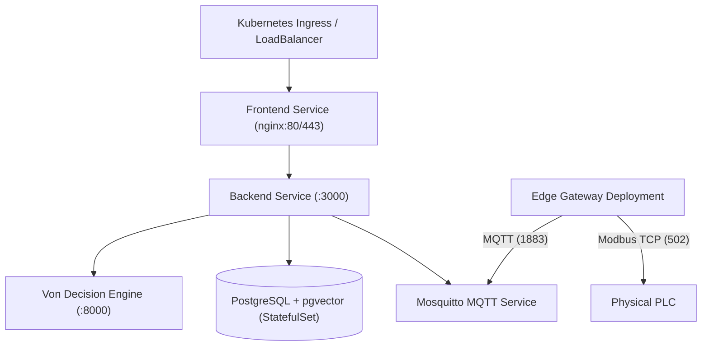

<!-- SPDX-FileCopyrightText: 2026 Meddle S.r.l. -->
<!-- SPDX-License-Identifier: CC-BY-4.0 -->

# Production Kubernetes & Edge K3s Deployment

This directory contains production Kubernetes/K3s deployment manifests for the Fault Diagnosis platform.

---

## 1. Architecture in Kubernetes



---

## 2. Quickstart Deployment

### Step 1: Create Namespace and Configs
```bash
kubectl apply -f deploy/k8s/00-namespace.yaml
kubectl apply -f deploy/k8s/01-config-secrets.yaml
```

### Step 2: Deploy Storage & Core Infrastructure (Postgres, MQTT, Von)
```bash
kubectl apply -f deploy/k8s/02-postgres.yaml
kubectl apply -f deploy/k8s/03-mqtt.yaml
kubectl apply -f deploy/k8s/04-von.yaml
```

### Step 3: Deploy Applications (Backend, Frontend, Gateway)
```bash
kubectl apply -f deploy/k8s/05-backend.yaml
kubectl apply -f deploy/k8s/06-frontend.yaml
kubectl apply -f deploy/k8s/07-gateway.yaml
```

### Step 4: Verify All Pods Are Running & Healthy
```bash
kubectl get pods -n fault-diagnosis
```

---

## 3. Production Hardening Checklist

1. **Update Secrets:** Before deploying, replace the placeholder passwords in `01-config-secrets.yaml` with strong secrets or link to an external Secrets Store CSI (AWS Secrets Manager, HashiCorp Vault, Azure Key Vault).
2. **Ingress with TLS:** Add a cert-manager Ingress definition pointing to the `frontend` service on port 443 with a production TLS certificate.
3. **Database HA:** For critical enterprise deployments, replace the single StatefulSet with an operator-managed HA Postgres cluster (e.g., CloudNativePG or Zalando Postgres Operator) or an external managed database (AWS RDS / Azure Database for PostgreSQL).
