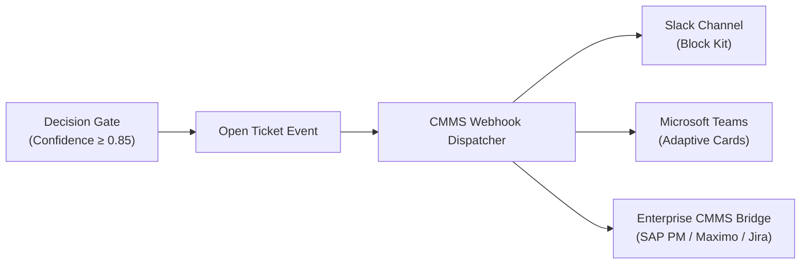

<!-- SPDX-FileCopyrightText: 2026 Meddle S.r.l. -->
<!-- SPDX-License-Identifier: CC-BY-4.0 -->

# CMMS & Enterprise Notification Integration

This guide describes how to connect the Fault Diagnosis system to Computerized Maintenance Management Systems (CMMS) such as SAP PM, IBM Maximo, Jira Service Management, or messaging channels like Slack, Microsoft Teams, and PagerDuty.

---

## 1. Overview

When the decision gate promotes a suspect event into a verified **ticket** or **review item**, the backend can automatically dispatch structured event payloads via webhooks.



---

## 2. Configuration

Enable external notifications by setting environment variables in `.env` or Docker Compose:

```env
# Slack notifications
CMMS_SLACK_WEBHOOK_URL=https://hooks.slack.com/services/YOUR_WORKSPACE/YOUR_CHANNEL/YOUR_TOKEN

# Microsoft Teams notifications
CMMS_TEAMS_WEBHOOK_URL=https://company.webhook.office.com/webhookb2/XXXXXXXX-XXXX-XXXX-XXXX-XXXXXXXXXXXX/IncomingWebhook/...

# Generic CMMS webhook (e.g. SAP PM / Maximo webhook proxy)
CMMS_WEBHOOK_URL=https://cmms-bridge.plant.internal/api/fault-tickets
CMMS_WEBHOOK_SECRET=your-hmac-sha256-signing-secret

# Webhook request timeout
CMMS_WEBHOOK_TIMEOUT_MS=5000
```

---

## 3. Webhook Payload Specification

When using `CMMS_WEBHOOK_URL`, the dispatcher sends an HTTP `POST` request with JSON:

```json
{
  "event": "fault.ticket.opened",
  "ticket": {
    "id": "tkt-01j98z345...",
    "fault": "downstream_air_leak",
    "confidence": 0.91,
    "severity": "ticket",
    "summary": "Rapid pressure drop in reservoir during idle phase indicates an active downstream air leak.",
    "unitId": "cau-7",
    "openedAt": "2026-11-15T14:30:00.000Z",
    "evidence": "Observed decay rate 0.42 bar/min exceeds baseline threshold 0.15 bar/min."
  }
}
```

### Signature Verification (HMAC-SHA256)

When `CMMS_WEBHOOK_SECRET` is set, every outgoing request includes an `X-FDP-Signature` header:

```http
X-FDP-Signature: sha256=d5b8...
```

To verify the payload in your receiver:

```javascript
const crypto = require("crypto");
const expected = "sha256=" + crypto.createHmac("sha256", secret).update(rawBody).digest("hex");
const valid = crypto.timingSafeEqual(Buffer.from(signature), Buffer.from(expected));
```

---

## 4. Connecting to Enterprise Systems

### SAP PM (Plant Maintenance)

Create a lightweight middleware (AWS Lambda, Cloud Run, or on-prem Python Flask service) listening to `CMMS_WEBHOOK_URL`. On receipt, it maps `ticket.fault` to an SAP functional location / equipment number and calls BAPI `BAPI_ALM_NOTIF_CREATE` to generate a Plant Maintenance notification.

### IBM Maximo

Configure Maximo Integration Framework (MIF) to accept REST JSON payloads, or point `CMMS_WEBHOOK_URL` to an integration endpoint that executes an `mxaction` or creates a `WORKORDER` record.

### Jira Service Management

Point `CMMS_WEBHOOK_URL` directly to an Automation for Jira webhook rule (`/rest/api/2/issue` or webhook automation rule trigger) to automatically open a maintenance task on the Reliability board.
